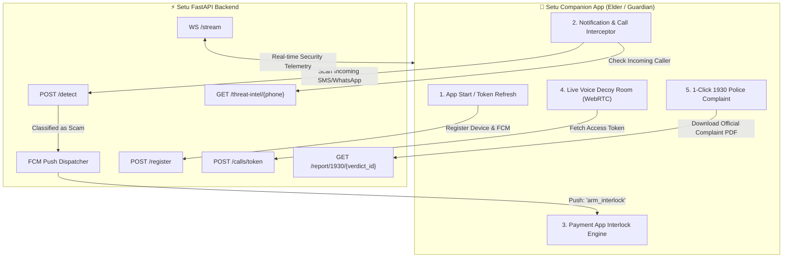

# 🛡️ SETU (सेतु) — Mobile App Master Integration Specification & Prompt

> **Copy & paste this complete document into your mobile app project (Android Kotlin / Flutter / React Native) to natively wire all backend features.**
> 
> * **Backend Base URL**: `https://<your-domain>` (or `http://10.0.2.2:8000` on Android Emulator / `http://<LAN_IP>:8000` on physical test device)
> * **Auth Header**: `Authorization: Bearer setu-dev-token` (required on all `POST` requests)
> * **WebSocket URL**: `wss://<your-domain>/stream?role=elder&device_id=<device_id>`

---

## 🏗️ Architecture & Interaction Flow



---

## 📡 Complete Mobile Feature & Route Catalog

### 1. App Launch: Register Device & FCM Push Token
Call this whenever the app launches or whenever Firebase refreshes the registration token.

* **Endpoint**: `POST /register`
* **Headers**: `Authorization: Bearer setu-dev-token`, `Content-Type: application/json`
* **Request Body**:
  ```json
  {
    "device_id": "elder_pixel_6a_01",
    "fcm_token": "<FCM_REGISTRATION_TOKEN>",
    "family_id": "fam_pune_9823"
  }
  ```
* **Response `200 OK`**:
  ```json
  {
    "status": "registered",
    "device_id": "elder_pixel_6a_01",
    "family_id": "fam_pune_9823"
  }
  ```

---

### 2. Live Message Scanning (WhatsApp & SMS)
Whenever the Android `NotificationListenerService` captures a notification from WhatsApp (`com.whatsapp`), WhatsApp Business (`com.whatsapp.w4b`), or default SMS, forward the text to `/detect`.

* **Endpoint**: `POST /detect`
* **Headers**: `Authorization: Bearer setu-dev-token`, `Content-Type: application/json`
* **Request Body**:
  ```json
  {
    "channel": "whatsapp",
    "sender": "+919876543210",
    "content": "Aapka electricity bill overdue hai, turant update karein warna power cut ho jayega tonight at 9PM. Link: http://bit.ly/mpeb-bill",
    "device_id": "elder_pixel_6a_01",
    "ts": "2026-11-01T04:30:00Z"
  }
  ```
* **Response `200 OK`**:
  ```json
  {
    "verdict_id": "v_d2d9ca7e",
    "is_scam": true,
    "scam_type": "kyc_phishing",
    "risk_score": 92.0,
    "evidence": [
      "Contains disguised/shortened link 'http://bit.ly/mpeb-bill' commonly used in phishing.",
      "Demands immediate payment under threat of disconnection."
    ],
    "action": "arm_interlock",
    "extracted_intel": {
      "urls": ["http://bit.ly/power-bill"],
      "phones": ["+919876543210"],
      "upi_ids": [],
      "accounts": []
    },
    "engine": "gemini"
  }
  ```
* **App Logic**:
  * If `is_scam == true` and `action == "arm_interlock"`:
    1. Activate the local **Payment App Interlock** (lock PhonePe/GPay/Paytm).
    2. Show a prominent **Red Scam Alert Banner** in notification tray & on screen.
    3. **Do NOT reply to the scammer.**
  * *Note: The backend automatically handles official `.gov.in` and `.bank.in` auto-exemption.*

---

### 3. Remote Interlock via High-Priority FCM Push Alert
When a scam is verified, the backend dispatches a high-priority FCM notification with custom data:

* **FCM Payload Delivered to App**:
  ```json
  {
    "notification": {
      "title": "⚠️ Fraud Alert: Electricity Bill Phishing",
      "body": "Sender +919876543210 sent a suspected fraud message. Do not pay or click links."
    },
    "data": {
      "cmd": "arm_interlock",
      "call_id": "v_d2d9ca7e",
      "risk_score": "92.0",
      "scam_type": "kyc_phishing",
      "scammer_number": "+919876543210",
      "channel": "whatsapp",
      "evidence": "[\"Contains disguised/shortened link...\", \"Demands payment...\"]"
    }
  }
  ```
* **App Logic**:
  * If `cmd == "arm_interlock"`:
    * Flag payment apps (PhonePe, GPay, Paytm, BHIM, Banking apps) as **LOCKED** using an `AccessibilityService` or `UsageStatsManager`.
    * If the elder attempts to open any UPI app, present a full-screen blocking overlay:  
      *"Setu Security Alert: Suspicious scam detected from +919876543210. Financial apps are temporarily locked to protect your savings. Contact your family guardian to unlock."*
  * If `cmd == "release_interlock"`:
    * Dismiss the overlay and re-enable payment apps.

---

### 4. Telemetry: Report Payment App Launch While Locked
If the elder taps or opens a payment app while the interlock is active, notify the backend and family dashboard:

* **Endpoint**: `POST /event`
* **Headers**: `Authorization: Bearer setu-dev-token`, `Content-Type: application/json`
* **Request Body**:
  ```json
  {
    "event_type": "payment_app_opened",
    "device_id": "elder_pixel_6a_01",
    "ts": "2026-11-01T04:31:00Z",
    "payload": {
      "app": "com.phonepe.app",
      "interlock_active": true,
      "blocked": true
    }
  }
  ```
* **Response `200 OK`**: `{"status": "received"}`

---

### 5. Incoming Caller Threat Reputation Lookup
When an incoming call rings, query the backend threat database in real time:

* **Endpoint**: `GET /threat-intel/{phone}` (URL encode `+` as `%2B`)
* **Example**: `GET /threat-intel/%2B919876543210`
* **Response `200 OK` (Known Scammer)**:
  ```json
  {
    "phone": "+919876543210",
    "known_scam": true,
    "reports": 58,
    "last_seen": "2026-10-31T06:15:00Z",
    "scam_types": ["digital_arrest", "fake_cbi"],
    "verdict": "auto_reject"
  }
  ```
* **Response `200 OK` (Clean / Unknown Caller)**:
  ```json
  {
    "phone": "+919811000000",
    "known_scam": false,
    "reports": 0,
    "last_seen": null,
    "scam_types": [],
    "verdict": "allow"
  }
  ```
* **App Logic**:
  * If `verdict == "auto_reject"`:
    * Show red caller-ID warning badge (*"Reported Scam: 58 times (CBI / Digital Arrest)"*).
    * Display button: **"Forward to Saroj Aunty (Voice Decoy)"**.

---

### 6. Guardian Approval Screen: Unlock Elder's Phone
Allows family members/guardians to review alerts and release the interlock:

* **Endpoint**: `POST /interlock/approve`
* **Headers**: `Authorization: Bearer setu-dev-token`, `Content-Type: application/json`
* **Request Body**:
  ```json
  {
    "alert_id": "v_d2d9ca7e",
    "approved_by": "Rohit (Son)",
    "decision": "approve"
  }
  ```
* **Response `200 OK`**:
  ```json
  {
    "status": "released",
    "alert_id": "v_d2d9ca7e",
    "approved_by": "Rohit (Son)"
  }
  ```
* *(The backend automatically dispatches `{ cmd: "release_interlock" }` to the elder's device via FCM to unlock it).*

---

### 7. Voice Decoy WebRTC Room Connection (LiveKit / Saroj Aunty)
To let an elder or tester forward a scam call into a live room where **Saroj Aunty** (Groq Whisper + Gemini + ElevenLabs) answers:

* **Endpoint**: `POST /calls/token`
* **Headers**: `Authorization: Bearer setu-dev-token`, `Content-Type: application/json`
* **Request Body**:
  ```json
  {
    "call_id": "call_pune_9012",
    "scammer_number": "+919876543210",
    "participant_name": "caller_elder_or_scammer"
  }
  ```
* **Response `200 OK`**:
  ```json
  {
    "token": "eyJhbGciOiJIUzI1NiIsInR5cCI6IkpXVCJ9...",
    "livekit_url": "wss://setu-stream-backend-q8cysa8o.livekit.cloud",
    "room": "call_call_pune_9012",
    "call_id": "call_pune_9012"
  }
  ```
* **App Native Action**:
  * Connect using the native `livekit-client` SDK (`Room.connect(livekit_url, token)`).
  * Listen in or let the scammer interact with the AI grandmother.

---

### 8. Fetch Call & Decoy Dialogue Transcript
To display the turn-by-turn dialogue of Saroj Aunty wasting the scammer's time:

* **Endpoint**: `GET /calls/{call_id}/transcript`
* **Response `200 OK`**:
  ```json
  {
    "call_id": "call_pune_9012",
    "turns": [
      {
        "speaker": "scammer",
        "text": "CBI Officer Sharma bol raha hoon. 50000 transfer karo.",
        "timestamp": "2026-11-01T04:32:00Z"
      },
      {
        "speaker": "saroj_aunty",
        "text": "Arre baap re! CBI officer sahab? Thoda rukiye na, mera chashma dhoondhti hoon...",
        "timestamp": "2026-11-01T04:32:02Z",
        "stt_ms": 110.2,
        "llm_ms": 480.5,
        "tts_ms": 610.1
      }
    ],
    "total_turns": 2
  }
  ```

---

### 9. 1-Click National Cybercrime Helpline 1930 Police Complaint PDF
Generates an official Indian Cybercrime police complaint dossier with incident evidence, transcript excerpts, and extracted mule accounts:

* **Endpoint (1-Click by Verdict ID)**:
  ```http
  GET /report/1930/{verdict_id}?elder_name=Saroj+Sharma&elder_phone=%2B919822012345
  ```
* **Response `200 OK`**:
  ```json
  {
    "status": "generated",
    "report_id": "1930_COMPLAINT_255320F6",
    "filename": "1930_COMPLAINT_255320F6.pdf",
    "report_url": "https://<your-domain>/static/reports/1930_COMPLAINT_255320F6.pdf"
  }
  ```
* **App Native Action**:
  * Open `report_url` in an in-app viewer or system PDF handler.
  * Provide a *"Share to Police / WhatsApp"* action.

---

### 10. Real-Time Telemetry Stream (`WS /stream`)
To display live alert cards, sound effects, or live risk meters in the app:

* **Connect**: `wss://<your-domain>/stream?role=elder&token=setu-dev-token`
* **Events Received in Real Time**:
  * `{"type": "risk_update", "call_id": "...", "risk_score": 0.92, "primary_indicator": "..."}`
  * `{"type": "arm_interlock", "call_id": "...", "scam_type": "digital_arrest", "reason": "..."}`
  * `{"type": "release_interlock", "alert_id": "...", "approved_by": "Rohit"}`
  * `{"type": "scam_blocked", "phone": "+91...", "estimated_loss_prevented_inr": 50000}`
  * `{"type": "transcript_chunk", "speaker": "saroj_aunty", "text": "..."}`

---

### 11. National Impact & Protection Stats (Dashboard Banner)
Shows total money protected and scam calls intercepted across the network:

* **Endpoint**: `GET /scam-economy/stats`
* **Response `200 OK`**:
  ```json
  {
    "time_wasted_min": 47,
    "money_saved_inr": 300000,
    "mule_accounts_exposed": 4,
    "scam_calls_blocked": 14,
    "scam_messages_blocked": 31,
    "weekly_trend": [4, 7, 11, 8, 15, 23]
  }
  ```

---

## 📋 Implementation Checklist for Mobile Developers

- [ ] **On Startup**: Call `POST /register` with device ID and FCM registration token.
- [ ] **Background Listener**: Hook `NotificationListenerService` (`com.whatsapp` / SMS) → forward payload to `POST /detect`.
- [ ] **FCM Message Handler**: Listen for `cmd == "arm_interlock"` → trigger full-screen lock and disable UPI app switching.
- [ ] **Incoming Call Screen**: Call `GET /threat-intel/{phone}` → show warning overlay if `verdict == "auto_reject"`.
- [ ] **Decoy Screen**: Call `POST /calls/token` → join WebRTC room using `livekit-client`.
- [ ] **Helpline Card**: Call `GET /report/1930/{verdict_id}` → open and share the official PDF complaint.

